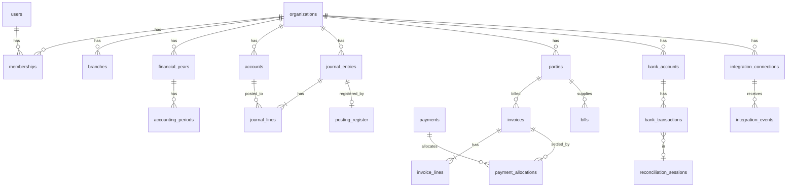

# FlowBook database schema (foundation)

PostgreSQL 16. Conventions: `id BIGINT GENERATED ALWAYS AS IDENTITY` primary keys; every tenant table has `organization_id BIGINT NOT NULL` and a composite unique `(organization_id, id)` so child foreign keys include the organization (a row can never point into another tenant); money in `BIGINT` minor units; `created_at/updated_at TIMESTAMPTZ`; RLS enabled on every tenant table with policy `organization_id = current_setting('app.org_id')::bigint`.

## 1. ER overview


## 2. Table list with key rules
| Table | Notes (PK is `id` unless stated) |
|---|---|
| users | email unique (citext), password_hash, mfa_secret_enc, status. Global, not tenant-owned |
| organizations | name, legal_name, pan, base_currency CHAR(3), timezone, region, fy_start_month, status, plan_id |
| memberships | (organization_id, user_id) unique; role_id; branch_scope bigint[] or NULL for all |
| roles, role_permissions | per organization custom roles; permission keys like `invoice.post`, `period.override` |
| branches | organization_id, name, gstin, state_code, address; unique (organization_id, name) |
| financial_years | start_date, end_date, status OPEN/CLOSED; no overlap (EXCLUDE USING gist on daterange) |
| accounting_periods | financial_year_id, start/end, status OPEN/SOFT_LOCKED/CLOSED; EXCLUDE overlap |
| accounts | code unique per org, name, type, group, normal_balance, is_system, parent_id, currency (NULL = base), active |
| journal_entries | entry_no per org series, entry_date, posting_date, status DRAFT/POSTED, source_type, source_id, memo, reverses_entry_id, currency, fx_rate NUMERIC(18,8), created_by, posted_at, rules_version |
| journal_lines | entry_id, line_no, account_id, side D/C (or signed amount), amount_minor BIGINT > 0, base_amount_minor, party_id, branch_id, item_id, tax_code_id, tax_rate NUMERIC(9,6), memo; CHECK amount_minor > 0 |
| posting_register | unique (organization_id, source_system, source_type, source_id, posting_kind) → entry_id; guards double posting |
| parties | type CUSTOMER/VENDOR/BOTH, name, gstin, pan, state_code, credit_days, external_ref, default_account_id |
| items | sku unique per org, name, kind GOODS/SERVICE, hsn_sac, unit_id, sale_price_minor, purchase_price_minor, tax_code_id, track_stock |
| tax_codes, tax_rates | tax_rates(effective_from, effective_to, cgst, sgst, igst, cess) no overlap per code; versioned |
| invoices | number unique per org+series, party_id, issue_date, due_date, status, place_of_supply, subtotal/tax/total_minor, balance_minor, journal_entry_id, einvoice_irn, einvoice_ack, version |
| invoice_lines | item_id, qty NUMERIC(18,6), unit_price_minor, discount_minor, taxable_minor, tax_code_id, tax_minor, hsn_sac |
| credit_notes, credit_note_lines | link to invoice |
| payments | direction IN/OUT, party_id, date, mode, reference, amount_minor, bank_account_id, status, journal_entry_id |
| payment_allocations | payment_id, document_type, document_id, amount_minor; CHECK sums ≤ payment and ≤ balance enforced by trigger |
| bills, bill_lines, purchase_orders, goods_receipts, expenses | mirror sales; expenses hold receipt attachment ids |
| bank_accounts | name, ledger_account_id, ifsc, last4, currency |
| bank_transactions | bank_account_id, txn_date, amount_minor signed, description, balance_minor, fingerprint unique (duplicate detection), status UNMATCHED/MATCHED/EXCLUDED, matched_entry_id |
| reconciliation_sessions | bank_account_id, statement_end_date, statement_balance_minor, status, closed_by |
| warehouses, inventory_movements | movement_type, item_id, warehouse_id, qty, unit_cost_minor, source_type/id, journal_entry_id |
| budgets, budget_lines | account_id, period, amount_minor |
| fixed_assets, depreciation_schedules | cost, salvage, method, life, posted flag per line |
| attachments | storage_key, sha256, owner_type/owner_id, size, mime |
| audit_log | append only; actor, action, entity_type/id, before_hash, after_hash, prev_hash, request_id, ip, ai_run_id |
| webhook_subscriptions, webhook_deliveries | url, secret_enc, events[], attempt log |
| integration_connections | provider, status, config_enc, cutover_date, last_sync_at |
| integration_events | connection_id, event_id, type, payload JSONB, status, error, attempts; unique (connection_id, event_id) |
| sync_jobs | job type, status, counts |
| notification_preferences | per user and org |
| plans, subscriptions, usage_records | plan feature keys; metered counters for e-invoice, messages, AI |

## 3. Foundational migration (excerpt, to be extended; not yet applied anywhere)
```sql
-- 0001_core.sql
CREATE EXTENSION IF NOT EXISTS citext;
CREATE EXTENSION IF NOT EXISTS btree_gist;

CREATE TABLE organizations (
  id BIGINT GENERATED ALWAYS AS IDENTITY PRIMARY KEY,
  name TEXT NOT NULL, legal_name TEXT, pan TEXT,
  base_currency CHAR(3) NOT NULL DEFAULT 'INR',
  timezone TEXT NOT NULL DEFAULT 'Asia/Kolkata',
  region TEXT NOT NULL DEFAULT 'in',
  fy_start_month SMALLINT NOT NULL DEFAULT 4 CHECK (fy_start_month BETWEEN 1 AND 12),
  status TEXT NOT NULL DEFAULT 'ACTIVE',
  created_at TIMESTAMPTZ NOT NULL DEFAULT now()
);

CREATE TABLE accounts (
  id BIGINT GENERATED ALWAYS AS IDENTITY PRIMARY KEY,
  organization_id BIGINT NOT NULL REFERENCES organizations(id),
  code TEXT NOT NULL, name TEXT NOT NULL,
  type TEXT NOT NULL CHECK (type IN ('ASSET','LIABILITY','EQUITY','INCOME','EXPENSE')),
  normal_balance CHAR(1) NOT NULL CHECK (normal_balance IN ('D','C')),
  is_system BOOLEAN NOT NULL DEFAULT false, active BOOLEAN NOT NULL DEFAULT true,
  UNIQUE (organization_id, id), UNIQUE (organization_id, code)
);

CREATE TABLE journal_entries (
  id BIGINT GENERATED ALWAYS AS IDENTITY PRIMARY KEY,
  organization_id BIGINT NOT NULL REFERENCES organizations(id),
  entry_no TEXT NOT NULL,
  posting_date DATE NOT NULL,
  status TEXT NOT NULL DEFAULT 'DRAFT' CHECK (status IN ('DRAFT','POSTED')),
  source_type TEXT NOT NULL, source_id TEXT NOT NULL,
  reverses_entry_id BIGINT,
  currency CHAR(3) NOT NULL, fx_rate NUMERIC(18,8) NOT NULL DEFAULT 1,
  rules_version INT NOT NULL,
  posted_at TIMESTAMPTZ,
  UNIQUE (organization_id, id), UNIQUE (organization_id, entry_no),
  FOREIGN KEY (organization_id, reverses_entry_id) REFERENCES journal_entries (organization_id, id)
);

CREATE TABLE journal_lines (
  id BIGINT GENERATED ALWAYS AS IDENTITY PRIMARY KEY,
  organization_id BIGINT NOT NULL,
  entry_id BIGINT NOT NULL, line_no INT NOT NULL,
  account_id BIGINT NOT NULL,
  side CHAR(1) NOT NULL CHECK (side IN ('D','C')),
  amount_minor BIGINT NOT NULL CHECK (amount_minor > 0),
  base_amount_minor BIGINT NOT NULL CHECK (base_amount_minor > 0),
  party_id BIGINT, branch_id BIGINT, tax_code_id BIGINT, tax_rate NUMERIC(9,6),
  FOREIGN KEY (organization_id, entry_id) REFERENCES journal_entries (organization_id, id),
  FOREIGN KEY (organization_id, account_id) REFERENCES accounts (organization_id, id),
  UNIQUE (entry_id, line_no)
);

-- balance check, evaluated at commit
CREATE FUNCTION check_entry_balanced() RETURNS trigger LANGUAGE plpgsql AS $$
DECLARE d BIGINT; c BIGINT; st TEXT;
BEGIN
  SELECT status INTO st FROM journal_entries WHERE id = NEW.entry_id;
  IF st = 'POSTED' THEN
    SELECT COALESCE(SUM(base_amount_minor) FILTER (WHERE side='D'),0),
           COALESCE(SUM(base_amount_minor) FILTER (WHERE side='C'),0)
      INTO d, c FROM journal_lines WHERE entry_id = NEW.entry_id;
    IF d <> c THEN RAISE EXCEPTION 'journal % is not balanced (% vs %)', NEW.entry_id, d, c; END IF;
  END IF;
  RETURN NULL;
END $$;
CREATE CONSTRAINT TRIGGER journal_lines_balanced AFTER INSERT OR UPDATE ON journal_lines
  DEFERRABLE INITIALLY DEFERRED FOR EACH ROW EXECUTE FUNCTION check_entry_balanced();

-- posted rows are immutable
CREATE FUNCTION block_posted_change() RETURNS trigger LANGUAGE plpgsql AS $$
BEGIN
  IF OLD.status = 'POSTED' THEN RAISE EXCEPTION 'posted journal entries are immutable'; END IF;
  RETURN CASE WHEN TG_OP = 'DELETE' THEN OLD ELSE NEW END;
END $$;
CREATE TRIGGER journal_entries_immutable BEFORE UPDATE OR DELETE ON journal_entries
  FOR EACH ROW EXECUTE FUNCTION block_posted_change();

CREATE TABLE posting_register (
  organization_id BIGINT NOT NULL, source_system TEXT NOT NULL, source_type TEXT NOT NULL,
  source_id TEXT NOT NULL, posting_kind TEXT NOT NULL, entry_id BIGINT NOT NULL,
  PRIMARY KEY (organization_id, source_system, source_type, source_id, posting_kind)
);

ALTER TABLE journal_entries ENABLE ROW LEVEL SECURITY;
CREATE POLICY tenant ON journal_entries
  USING (organization_id = current_setting('app.org_id')::bigint);
```
Note: the posting function inserts the entry as DRAFT, inserts its lines, then flips to POSTED in the same transaction; the deferred trigger (which also fires on that status update in the full migration) checks the balance at commit. Lines of a POSTED entry get the same immutability trigger (omitted above for length).

## 4. Document-to-ledger relationship
Documents hold `journal_entry_id` of their posting. Void or edit of a posted document posts a reversal entry (`reverses_entry_id`) and, for an edit, a new entry; the document's `version` increments. The ledger remains auditable even if the document is later archived.

## 5. Retention
Journals, documents, tax records: keep at least the statutory period (commonly 72 months after the annual return due date, *verify*); personal fields on parties are anonymised on erasure requests but the party row and numbers stay. Audit log: same period. Integration payloads: 18 months.
