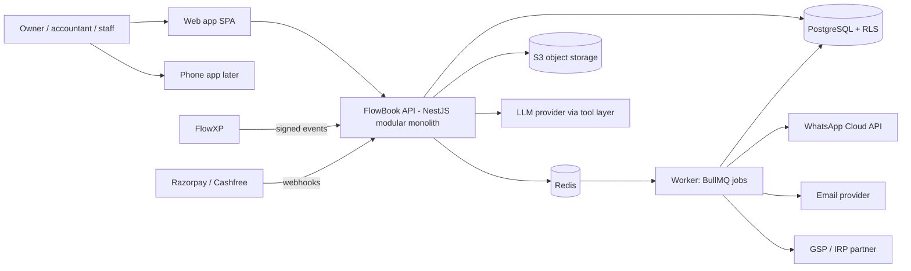
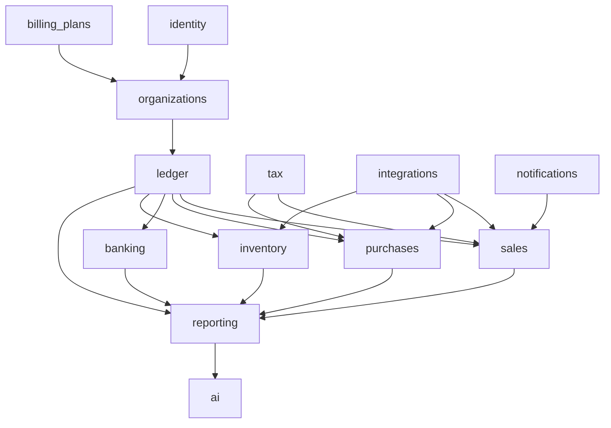
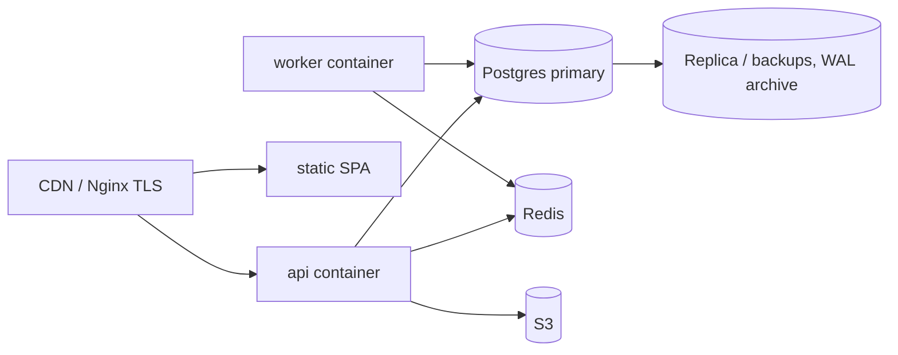
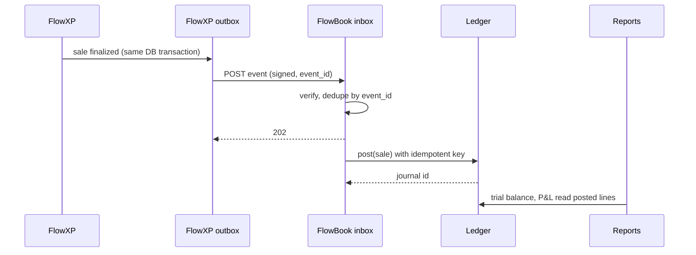
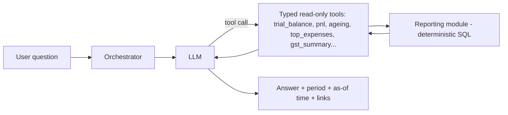

# FlowBook system architecture

Diagrams are Mermaid (render in GitHub or any Mermaid viewer). See architecture-decisions.md for the reasoning (D-01 to D-14).

## 1. Context and components


## 2. Modules and allowed dependencies

Rule: arrows point to the module that may be called. `ledger.post()` is the only writer of journals. Reporting reads only. `ai` calls reporting through the same functions the UI uses.

## 3. Request flow for a posted document
1. Request arrives with session and `Idempotency-Key`.
2. Middleware sets `app.org_id`, `app.user_id` in the DB session (RLS) and checks permission + branch scope.
3. Sales module validates the invoice, asks `tax` for tax lines (rule version stored).
4. In one transaction: insert invoice, `ledger.post(source)` creates the journal and lines, insert posting register row (unique key), insert audit row, insert outbox rows (webhooks, notifications).
5. Commit; worker delivers outbox items.
Retry of step 1 with the same key returns the stored response.

## 4. Deployment (initial)

Two containers from one image (api, worker). Postgres on a managed or self-run primary with continuous WAL archiving for point-in-time recovery. Environments: local, staging (with government sandbox credentials), production.

## 5. Data flow: FlowXP sale to financial statements


## 6. Payment gateway reconciliation
```mermaid
sequenceDiagram
  participant C as Customer
  participant G as Gateway
  participant B as FlowBook
  C->>G: pays invoice link
  G->>B: webhook payment.captured (signed)
  B->>B: dedupe by gateway event id, match invoice by link/reference
  B->>B: post Dr Gateway Clearing, Cr AR; allocate to invoice
  G->>B: settlement report later
  B->>B: Dr Bank, Dr Fees, Dr Input GST, Cr Gateway Clearing
```

## 7. Reliability and failure recovery
- Outbox + inbox patterns on both sides; at-least-once delivery, idempotent processing.
- Worker crash: BullMQ retries with backoff; stalled-job detection; jobs are safe to repeat.
- Database failure: failover to replica promoted manually at launch; PITR restore drill quarterly.
- Poison events go to a dead-letter table with a replay button.
- Daily reconciliation job: sub-ledger vs control accounts, FlowXP day totals vs FlowBook postings, bank balance vs ledger. Failures raise an alert and a banner in the app.
- Runbooks in deployment-and-operations.md.

## 8. AI layer

- Tools are read-only and tenant-scoped by the same RLS session. The model gets numbers only through tools and must quote them; a post-check verifies that every number in the answer appears in a tool result, otherwise the answer is replaced with a refusal.
- Forecasts come from a separate deterministic function (e.g. receivables due dates and recurring bills) and are labelled "forecast".
- Write actions (create a draft invoice, send a reminder) produce a **proposal** the user must confirm; the model has no credentials to post, edit or delete journals. Every AI-assisted action is audited with the prompt id, tools called and the confirming user.

## 9. Module dependency test
A CI test parses imports and fails if a module imports another's internals or if anything other than `ledger` inserts into `journal_*`.

## 10. Threat model (STRIDE summary)
| Threat | Example | Control |
|---|---|---|
| Spoofing | forged FlowXP event | HMAC signature, timestamp window, per-connection secret |
| Tampering | editing a posted entry | triggers, no UPDATE grants, hash-chained audit |
| Repudiation | "I did not void that" | audit log with actor and request id |
| Information disclosure | cross-tenant read | RLS, composite FKs, tests that run every endpoint as org A reading org B ids |
| Denial of service | huge report, webhook flood | rate limits, query timeouts, async exports, queue limits |
| Elevation | accountant sees clients they are not assigned | membership table checks, no org id from client payload |
| AI-specific | prompt injection from a customer name | tool-only data path, model has no write tools, output check |
